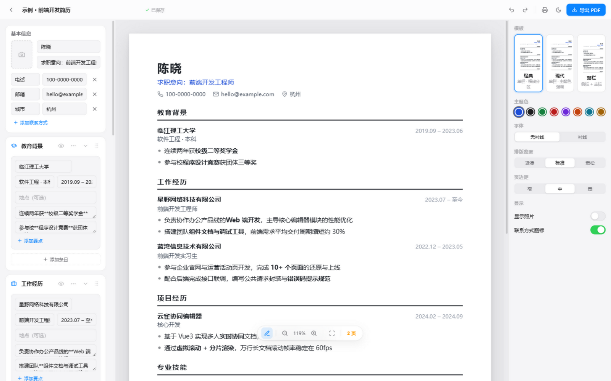
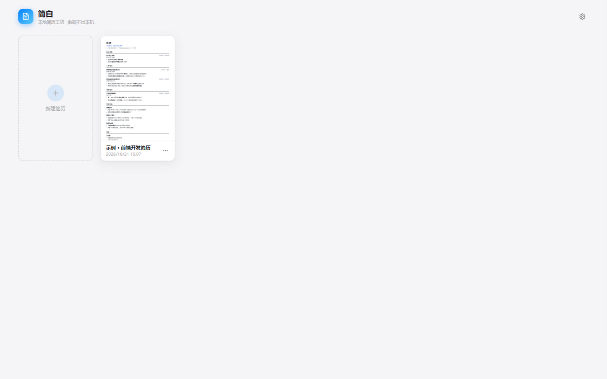
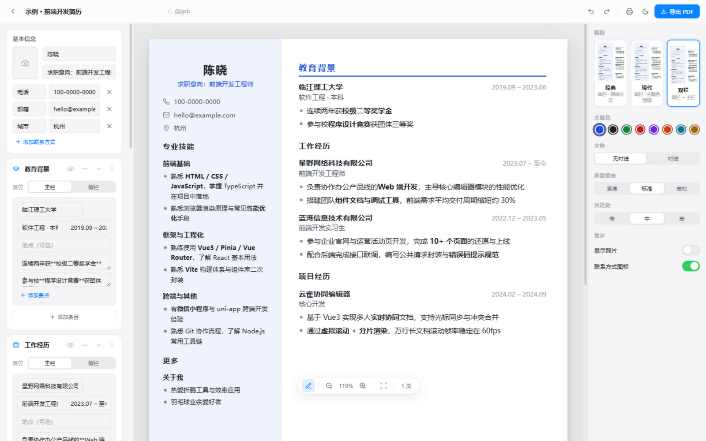
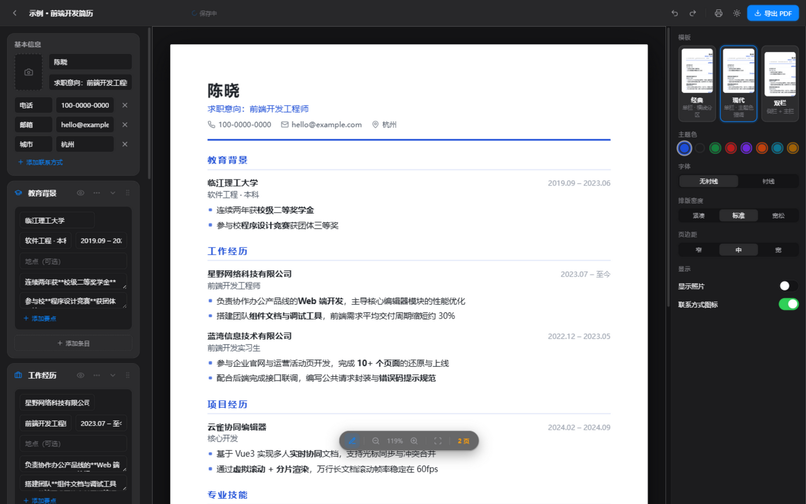

<div align="center">

# 简白 JianBai

**免费 · 无水印 · 数据不出本机的简历工坊**

*内容样式分离 · 所见即所得 · 纸上直编 · 一键导出 PDF*

[](https://vuejs.org)
[](https://vitejs.dev)
[](https://www.typescriptlang.org)
[](#-数据与隐私)

**[下载使用](#-快速开始) · [功能总览](#-功能总览) · [导出 PDF](#-导出-pdf)**

[简体中文](README.md) | [English](README_EN.md)

</div>

---

## 为什么做它

市面上的简历工具：编辑免费、保存收费、导出水印、内容上云。

简白反着来——**所有数据只存在你自己的浏览器里**，没有账号、没有会员、没有水印。打开就是一张 A4 纸，左边填内容、右边调样式、中间实时看效果，点一下导出就是 PDF。

## 功能总览

| | |
|---|---|
|  |  |
| **三栏编辑器**：左栏填内容，中间 A4 实时预览，右栏换模板调样式 | **多简历管理**：卡片实时缩略渲染，重命名 / 副本 / JSON 导入导出 |
|  |  |
| **三套模板**：经典 / 现代 / 双栏（分区可指定主栏或侧栏落位） | **深色模式**：跟随系统或手动切换，纸张恒白不刺眼 |

### 更多亮点

- **粘贴文本导入**：把旧简历的文字整段粘进来（纯文本 / Word / PDF / 网页都行），本地自动识别姓名、联系方式、分区与条目，预览确认后一键成稿
- **数据更抗造**：存储升级到 IndexedDB（数百 MB 起步，照片再多也不怕）；首次打开自动迁移旧 localStorage 数据
- **备份双保险**：首页智能提醒「该备份了」（从未备份 / 有新改动超过 3 天都会提示）；设置里可绑定本地文件夹，保存后自动把全量备份写进去（File System Access，数据依旧不出本机）
- **纸上直编**：预览纸张上点击文字直接修改，选中即出加粗工具条，所见即所得
- **拖拽排序**：分区、条目拖拽调整位置，带插入指示线
- **导出双通道**：一键下载 PDF（免打印对话框、无页眉页脚、智能分页不切断条目）；另有矢量打印版（文字可选中，求职系统解析友好）
- **撤销重做**：Ctrl+Z / Ctrl+Shift+Z，100 步快照
- **自动保存**：边写边存，刷新、关闭浏览器都不丢
- **样式系统**：8 种主题色 × 2 种字体 × 3 档排版密度 × 3 档页边距，随意组合不丢内容

## 快速开始

### 方式一：直接使用（推荐）

```bash
git clone https://github.com/old884888/ResumeGo.git
```

打开仓库里的 **`dist/index.html`**——双击即可使用，单文件、离线可用、无需安装任何东西。

### 方式二：本地开发

```bash
npm install
npm run dev        # http://127.0.0.1:5173
npm run build      # 生产构建 → dist/index.html（单文件）
npm run typecheck  # 类型检查
npm test           # 单元测试（解析器 / 备份提醒规则）
```

> Node.js 18+，推荐 Chrome / Edge 浏览器（自动备份文件夹功能依赖 File System Access API）。

## 导出 PDF

**「导出 PDF」（主按钮）**：点击直接下载 PDF，无对话框、无页眉页脚，内容按 A4 智能分页，条目不会被拦腰切断。

**「矢量打印版」（打印机图标）**：走浏览器打印管线，文字可选中复制（招聘系统解析更友好）。打印时建议：

1. 目标打印机选「另存为 PDF」
2. 取消勾选「页眉和页脚」
3. 边距选「无」
4. 勾选「背景图形」

## 数据与隐私

- 所有数据仅保存在**浏览器本地**（IndexedDB），不经过任何服务器
- 可在「设置」绑定一个本地文件夹，每次保存自动写入全量备份 —— 浏览器数据被清空也炸不掉它
- 首页会在「该备份了」的时候智能提醒，一键导出 JSON
- 照片上传时本地压缩后存储
- 内置的示例简历为**纯虚构数据**，可随意删改
- ⚠️ 未绑定自动备份文件夹时，清除浏览器数据 = 删除简历，请留意首页的备份提醒

## 技术栈

Vue 3.5 · TypeScript · Vite 5 · Pinia · Vue Router · lucide-icons

> 刻意不使用 UI 组件库——设计语言（留白、毛玻璃、克制动效）全部手搓，只为那一点果味。

```
src/
├── models/       # 数据模型、示例数据、富文本与文件工具
├── stores/       # Pinia：文档集合 / 编辑会话 / 偏好
├── composables/  # 快照式撤销重做
├── components/
│   ├── preview/  # A4 纸张 + 三套模板 + 纸上直编
│   ├── editor/   # 三栏：内容表单 / 预览面板 / 样式面板
│   ├── home/     # 列表页卡片
│   └── ui/       # 手搓果风组件（按钮/分段控件/开关/弹窗/菜单）
├── pages/        # 首页 / 编辑器 / 设置
└── styles/       # 设计 tokens、纸张排版、打印管线

---

<div align="center">

**如果简白帮你省了点时间，一个 Star 就是最好的回礼。⭐**

</div>
```

## 路线图

- [x] 结构化编辑 + 实时预览 + PDF 导出
- [x] 三套模板 / 主题色 / 密度边距 / 深色模式
- [x] 纸上直编 + 选词加粗 + 拖拽排序 + 撤销重做
- [ ] PNG 长图导出 · 手动分页符 · 简历完整度提示
- [ ] AI 润色（用户自带 API Key，数据仍不出本机）
- [ ] 英文简历模板 · Electron 桌面壳

---

<div align="center">

如果帮到了你，点个 **Star** 就是最大的鼓励 ⭐

</div>
